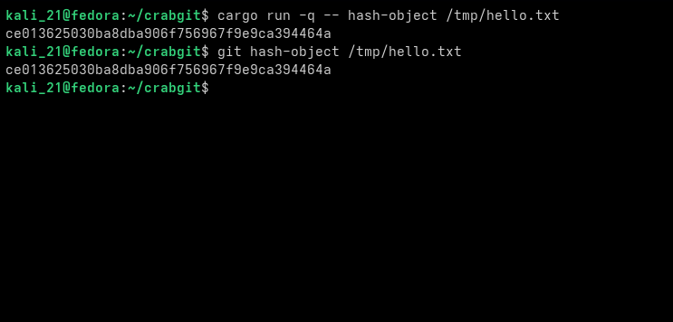

# Gitlet

A tiny Git implementation written from scratch in Rust, built to learn how Git works under the hood — and to learn Rust along the way.

Objects created by crabgit use the exact same format as real Git, so Git can read them.



## Features

- `crabgit init` — create an empty repository in `.crabgit/`
- `crabgit hash-object <file>` — hash a file as a blob, compress it with zlib, and store it in `.crabgit/objects/`

## Build

Requires [Rust](https://www.rust-lang.org/tools/install) (stable).

```bash
git clone https://github.com/kali21rt/crabgit.git
cd crabgit
cargo build --release
```

The binary will be at `target/release/crabgit`.

## Usage

```bash
$ crabgit init
Initialized empty crabgit repository in .crabgit/

$ echo "hello" > hello.txt
$ crabgit hash-object hello.txt
ce013625030ba8dba906f756967f9e9ca394464a
```

Compare with real Git — the hash is identical:

```bash
$ git hash-object hello.txt
ce013625030ba8dba906f756967f9e9ca394464a
```

## How it works

Git stores every file as a **blob object**:

```
blob <size>\0<content>
```

1. Gitlet builds this header + content, e.g. `blob 6\0hello\n`
2. Computes its **SHA-1** hash → `ce013625030ba8dba906f756967f9e9ca394464a`
3. Compresses it with **zlib**
4. Stores it at `.crabgit/objects/ce/013625030ba8dba906f756967f9e9ca394464a`
   (first 2 characters = directory, the rest = file name)

Because the format matches Git exactly, you can copy a crabgit object into a real Git repository and read it with `git cat-file -p`.

## Roadmap

- [x] `init`
- [x] `hash-object`
- [ ] `cat-file` — read and decompress objects
- [ ] `write-tree` — store directories as tree objects
- [ ] `commit` — create commit objects
- [ ] `log` — show commit history
- [ ] `add` — staging area (index)
- [ ] `branch` / `checkout`

## Why?

This is a learning project. I'm learning Rust by rebuilding a tool I use every day, one command at a time.

## License

MIT
